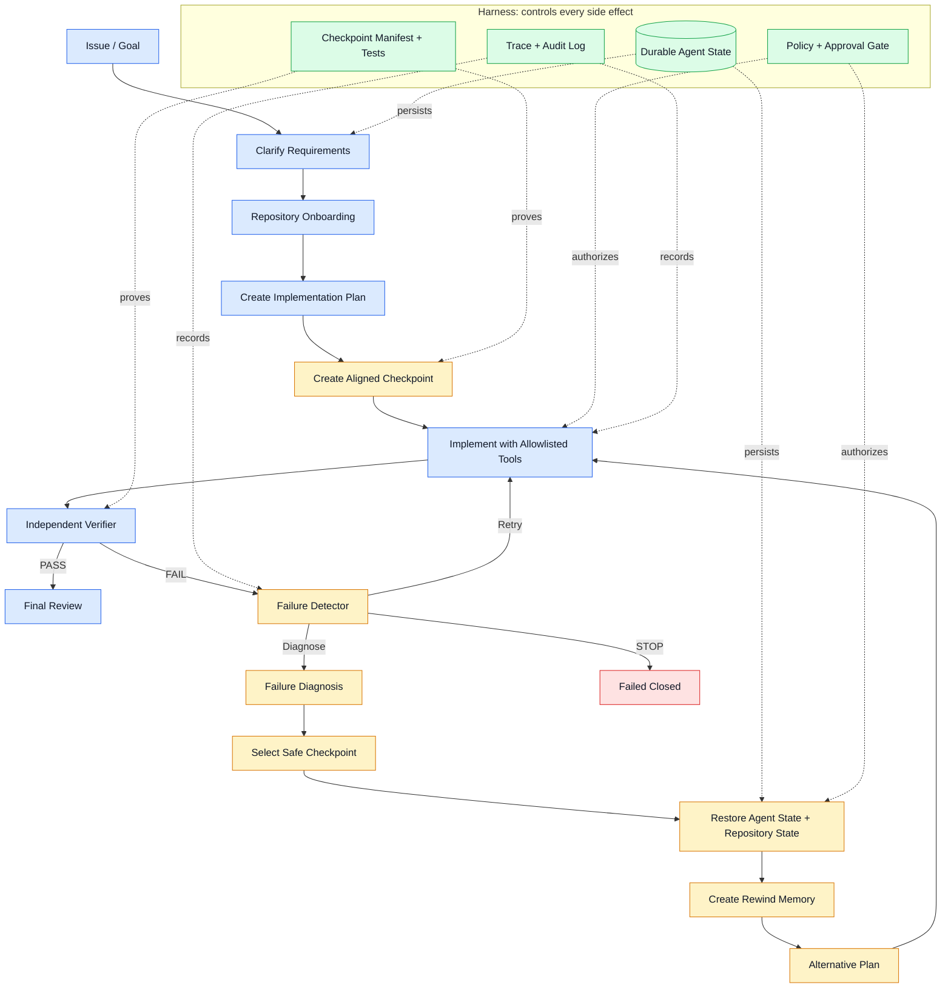

# Architecture

## Core invariant

A **recoverable checkpoint** is valid only when one `checkpoint_id` identifies
both a serializable `RewindCoderState` and an immutable repository snapshot
manifest. Restore is not complete until the repository adapter restores the
workspace and the verifier confirms the manifest, `git diff`, and target tests.

## Architecture at a glance



Đọc sơ đồ theo ba lớp:

1. **Core workflow:** hiểu issue, lập kế hoạch, sửa code và kiểm chứng.
2. **Recovery loop:** khi verifier báo lỗi, hệ thống retry, diagnose hoặc rewind
   về checkpoint an toàn rồi lập kế hoạch khác.
3. **Harness:** state, policy, trace và verification kiểm soát mọi side effect;
   model không được tự có quyền đọc/ghi hoặc chạy command.

## MVP control flow

```text
parse issue -> onboard repository -> plan -> checkpoint -> implement
-> test/verify -> diagnose -> select safe checkpoint -> approved restore
-> inject rewind memory -> replan -> implement
```

The current implementation contains framework-neutral contracts. Future
adapters can map the workflow to LangGraph, connect an LLM provider, collect
Git metadata, capture a workspace snapshot, and execute approved commands in a
sandbox. Adapters must not change the core invariant.

## Boundaries

| Component | Owns | Must not own |
|---|---|---|
| Agent | task state and plans | shell execution or filesystem mutation |
| Checkpoint manager | metadata persistence | unverified workspace restore |
| Recovery | policy, selection, memory | bypassing approval |
| Tools | controlled side effects | agent planning |
| Verifier | independent completion evidence | patch generation |
