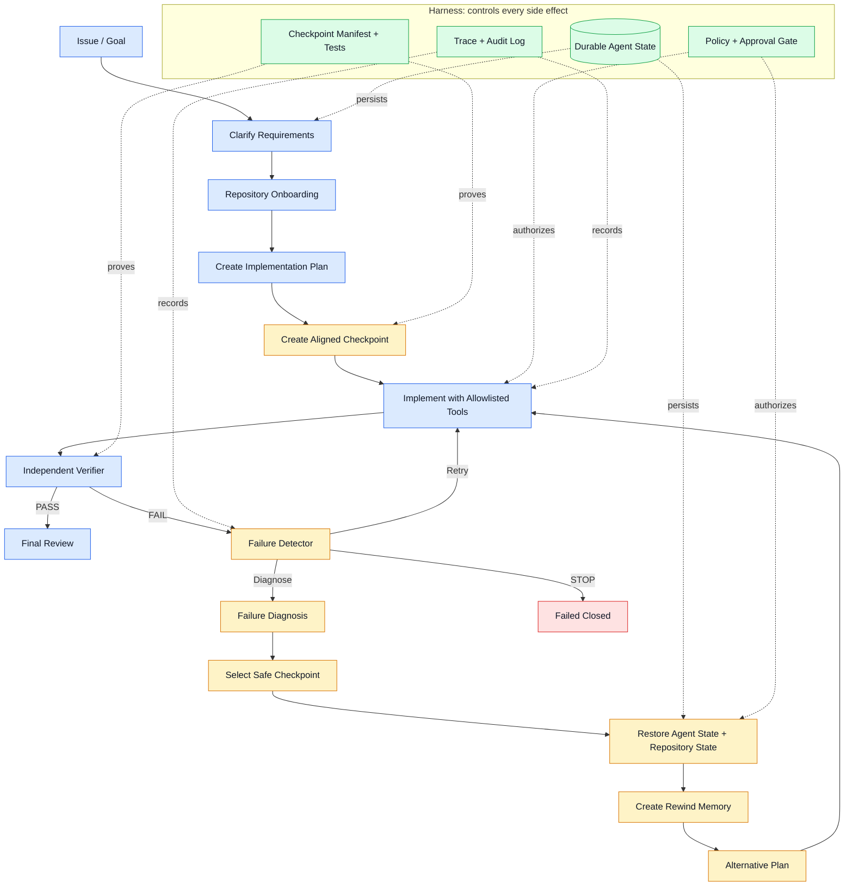

# Architecture

## Core invariant

A **recoverable checkpoint** is valid only when one `checkpoint_id` identifies
both a serializable `RewindCoderState` and an immutable repository snapshot
manifest. Restore is not complete until the repository adapter restores the
workspace and the verifier confirms the manifest, `git diff`, and target tests.

## Architecture at a glance



Đọc sơ đồ theo ba lớp:

1. **Core workflow:** hiểu issue, lập kế hoạch, sửa code và kiểm chứng.
2. **Recovery loop:** khi verifier báo lỗi, hệ thống retry, diagnose hoặc rewind
   về checkpoint an toàn rồi lập kế hoạch khác.
3. **Harness:** state, policy, trace và verification kiểm soát mọi side effect;
   model không được tự có quyền đọc/ghi hoặc chạy command.

## MVP control flow

```text
parse issue -> onboard repository -> plan -> checkpoint -> implement
-> test/verify -> diagnose -> select safe checkpoint -> approved restore
-> inject rewind memory -> replan -> implement
```

## Implemented Phase 2 path

```text
parse_issue -> clarify_requirements -> repo_onboarding -> create_plan
-> implement -> run_target_tests -> run_regression_tests -> verify
-> final_review | stop
```

This path runs once and never enters the recovery nodes. The mock provider
receives only `TaskContract.to_agent_payload()` and public fixture source/tests.
The tool layer owns reads, edits, searches, Git status/diff, and tests. The
verifier consumes actual test and Git evidence. The CLI writes a patch, JSONL
trace, and run manifest for every controlled run that reaches the workflow.

Phase 3 adds a separate manual path: `checkpoint create` captures agent state,
Git-visible workspace bytes and passing target-test evidence into an external
bundle; `rewind --checkpoint` applies both states after explicit approval, then
an independent verifier checks manifest, Git diff, agent state and target tests.
The forward-only agent workflow above remains available. Phase 4 adds an
explicit `run --recovery-scenario` branch for the reviewed parser fixture:
`checkpoint -> faulty edit -> public tests -> diagnose -> repeated-failure
decision -> select validated bundle -> approved aligned restore -> structured
memory -> alternative edit -> independent final verifier`. It calls the same
Phase 3 restore path. Other repositories cannot enter this automatic branch.

Phase 5 adds a frozen fixture-smoke matrix around the same controlled runner.
Six policies share a task/base/provider/seed/budget and write raw trace,
manifest, patch and checkpoint evidence. The evaluator records unsupported
cells, validates source and artifact hashes, computes descriptive metrics and
can replay a manifest in a new disposable fixture. The one-sided branches
intentionally fail the unchanged independent restore verifier. This smoke
matrix is not an arbitrary-repository benchmark or a release-ready v1.0.

## Boundaries

| Component | Owns | Must not own |
|---|---|---|
| Agent | task state and plans | shell execution or filesystem mutation |
| Checkpoint manager | metadata persistence | unverified workspace restore |
| Recovery | policy, selection, memory | bypassing approval |
| Tools | controlled side effects | agent planning |
| Verifier | independent completion evidence | patch generation |
